  

### Summary

Software Engineer and Informatics student at **Universitas Sebelas Maret (UNS)**, Surakarta.  
Specializing in distributed fullstack web architecture, mining fleet telematics gateways, and embedded IoT systems.

---

## 🚀 Production Systems & Architecture

| Platform / Repository | Domain & Scope | Core Architecture & Protocols | Tech Stack |
|:---|:---|:---|:---|
| **[PT HPU Fleet Telematics](https://github.com/CahyaDwiSaputra/Magang-HPU)** | Mining Industrial IoT | Dual-channel MDVR CCTV streaming (road and cabin view), haul road GPS tracking with stationing markers (STA), and real-time ADAS/DMS safety event alerts | `Laravel 13` `React 19 (Inertia)` `CMSV6 Gateway` `PostgreSQL` |
| **[cuan.in Escrow Platform](https://github.com/CahyaDwiSaputra/cuanin)** | Fintech & E-Commerce | Centralized escrow payment vault, automated Midtrans QRIS charge, Iris bank payout disbursement, and tenant subdomain routing | `Node.js` `Express` `PostgreSQL` `Midtrans Snap & Iris API` |
| **[GrowMatic Smart Farming](https://github.com/CahyaDwiSaputra/GrowMatic)** | AgriTech Automation | Oyster mushroom microclimate sensor telemetry (temperature, air/soil humidity) and automated misting irrigation actuation | `ESP32` `Arduino Uno` `DHT11` `Soil Sensors` `MySQL` |
| **[Hostuner Cloud Platform](https://github.com/CahyaDwiSaputra/hostuner-webhosting)** | Hosting Infrastructure | Web hosting and cloud VPS storefront integrated with WHMCS billing APIs for automated provisioning and invoice lifecycles | `Vite` `React` `Express` `PostgreSQL` `WHMCS API` |
| **[Embedded Systems Lab](https://github.com/CahyaDwiSaputra/arduino-iot-collection)** | Microcontroller Firmware | MFRC522 RFID smart doorlock with SG90 servo actuation, Blynk IoT weather station, and HC-SR04 ultrasonic proximity radar | `C++` `ESP32` `Arduino Uno` `SPI` `I2C` `UART` |

---

## 🛠️ Technical Toolkit

| Category | Primary Technologies & Tooling |
|:---|:---|
| **Core Languages** |        |
| **Backend & Distributed Systems** |      |
| **Frontend & Client Architecture** |      |
| **Databases & DevOps** |       |
| **IoT, Telematics & Hardware** |      |

---

## 📊 Production Source Code Distribution

| Language | Proportion | Byte Volume | Production Focus & Scope |
|:---|:---:|:---:|:---|
| **TypeScript** | `56.2%` | 3.65 MB | Frontend applications, React 19 Inertia interfaces, Next.js, and typed backend APIs |
| **JavaScript** | `14.7%` | 957 KB | Node.js Express escrow services, payment webhooks, and client logic |
| **HTML / Templates** | `12.3%` | 796 KB | Laravel Blade view structures and web storefront markup |
| **PHP** | `6.8%` | 442 KB | Laravel 13 core, telematics ingestion workers, and authentication guards |
| **Python** | `6.2%` | 402 KB | Data processing, sensor data analysis, and mathematical algorithms |
| **C / C++** | `2.5%` | 160 KB | Microcontroller firmware for ESP32 and Arduino Uno hardware systems |
| **Others** | `1.3%` | 85 KB | Dart (Flutter mobile), SQL database schemas, and Dockerfile configurations |

---

## 🎓 Education & Background

* **Universitas Sebelas Maret (UNS)**, Surakarta  
  Diploma in Informatics (D3 Teknik Informatika)  
  *Focus: Fullstack Web Architecture, Vehicle Telematics, and Embedded IoT Systems*

---

## 📬 Contact & Links

* **Email:** [cahyadwisaputra@student.uns.ac.id](mailto:cahyadwisaputra@student.uns.ac.id)
* **GitHub:** [github.com/CahyaDwiSaputra](https://github.com/CahyaDwiSaputra)
* **Location:** Surakarta, Central Java, Indonesia
