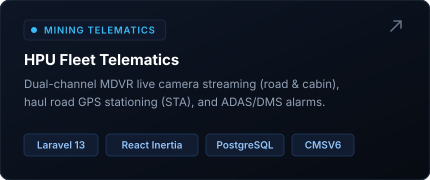
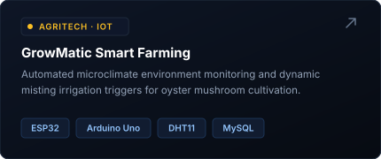

  

<h1 align="center">Cahya Dwi Saputra</h1>

  

  
  &nbsp;
  

---

### Overview

Informatics student at Universitas Sebelas Maret (UNS) based in Surakarta, Indonesia. My work focuses on backend architectures, distributed web platforms, and vehicle telematics hardware integrations.

Current engineering projects:
* Telematics pipelines: processing live dual-channel MDVR dashcam video and haul road stationing markers (STA) via CMSV6 gateways for mining fleet management at PT HPU.
* Financial systems: building multi-tenant escrow payment vaults with Midtrans QRIS checkout, webhook verification, and automated disbursement workflows on cuan.in.
* IoT systems: developing automated microclimate monitoring and misting irrigation logic on ESP32 and Arduino microcontrollers for agricultural cultivation.

---

### Production Systems

  
  

  
  

---

### Technical Toolkit

  

  

---

### Activity &amp; Performance

  

  

