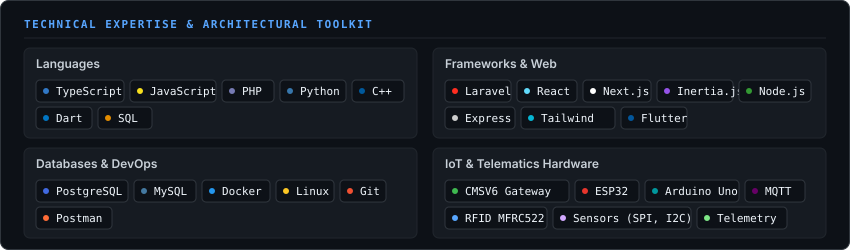

  

Software Engineer and Informatics student at Universitas Sebelas Maret (UNS), Surakarta.
Focused on building reliable fullstack web platforms, fleet telematics pipelines, and embedded IoT systems. Experienced in distributed application architecture with Laravel and Node.js, live camera streaming integrations, and edge sensor automation.

---

## Featured Projects

### [HPU Dashcam & Telemetry Monitoring System](https://github.com/CahyaDwiSaputra/Magang-HPU)
Enterprise fleet monitoring platform engineered for PT HPU mining operations.
* **Dual-Channel Video Streaming:** Integrates with CMSV6 media gateways to stream road and cabin views with low latency.
* **Live Telemetry & Mapping:** Tracks real-time GPS coordinates, hauling road stationing (STA), speed, and fuel levels on interactive maps.
* **Safety Event Processing:** Synchronizes ADAS and DMS events, including harsh braking, sharp turns, collision alerts, and driver distraction warnings.
* **Stack:** `Laravel 13` `React 19 (Inertia.js)` `Tailwind CSS` `PostgreSQL` `CMSV6`

### [cuan.in: MSME Storefront & Centralized Escrow](https://github.com/CahyaDwiSaputra/cuanin)
Centralized payment escrow gateway and multi-tenant website builder for Indonesian merchants.
* **Escrow Guarantee:** Protects transactions by holding payments via Midtrans QRIS and disbursing funds automatically once delivery is confirmed.
* **Tenant Isolation:** Separates central platform marketing from isolated merchant storefronts hosted on dedicated subdomains.
* **Stack:** `Node.js` `Express` `PostgreSQL` `Midtrans Snap` `Iris API`

### [GrowMatic: Smart Farming & Microclimate Automation](https://github.com/CahyaDwiSaputra/GrowMatic)
IoT environmental monitoring and microclimate control system for oyster mushroom cultivation.
* **Environmental Telemetry:** Monitors ambient temperature, air humidity, and substrate moisture levels in real time.
* **Automated Actuation:** Controls misting pumps and ventilation fans dynamically based on sensor threshold rules.
* **Stack:** `ESP32` `Arduino Uno` `DHT11` `Soil Sensors` `JavaScript` `MySQL`

### [Hostuner: Cloud Webhosting Platform](https://github.com/CahyaDwiSaputra/hostuner-webhosting)
Storefront and provisioning portal for webhosting, domain registrations, and cloud VPS instances.
* **WHMCS Integration:** Connects directly with WHMCS billing APIs for domain availability lookups, automated package provisioning, and invoice lifecycle management.
* **Stack:** `Vite` `React` `Node.js Express` `PostgreSQL` `WHMCS API`

### [Embedded Systems & Sensor Lab](https://github.com/CahyaDwiSaputra/arduino-iot-collection)
Curated collection of microcontroller firmware implementations across ESP32 and Arduino platforms.
* **Implementations:** ESP32 RFID MFRC522 smart doorlock with SG90 servo actuation, wireless environmental station streaming to Blynk IoT Cloud, and ultrasonic proximity radar with 16x2 I2C LCD readouts.
* **Stack:** `C++` `ESP32` `Arduino Uno` `SPI` `I2C` `Blynk IoT`

---

## Technical Expertise

  

---

## Codebase Language Distribution

  

---

## Education

* **Universitas Sebelas Maret (UNS)**, Surakarta  
  Diploma in Informatics / Computer Science

---

## Contact

* Email: cahyadwisaputra@student.uns.ac.id
* GitHub: [github.com/CahyaDwiSaputra](https://github.com/CahyaDwiSaputra)
* Location: Surakarta, Indonesia
