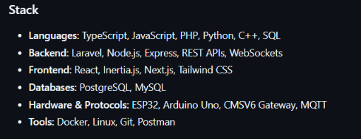

  

  

# Cahya Dwi Saputra

Informatics student at Universitas Sebelas Maret (UNS), Surakarta. Working on backend architectures, industrial vehicle telematics, and edge microcontrollers.

Currently:
* Building mining fleet telematics (CMSV6 gateway, dual-channel MDVR live streaming, haul road GPS stationing) at **PT HPU**.
* Maintaining **cuan.in**, an automated escrow payment vault for Indonesian MSMEs with Midtrans QRIS and Iris disbursements.
* Developing microclimate monitoring and misting automation firmware on **ESP32** and **Arduino** for smart agriculture (**GrowMatic**).

### Projects

* **[Magang-HPU](https://github.com/CahyaDwiSaputra/Magang-HPU)**  
  Industrial fleet monitoring system for mining haul trucks. Streams dual-channel MDVR dashcam video (road and cabin views), records GPS coordinates against haul road stationing markers (STA), and captures real-time ADAS/DMS safety events.  
  `Laravel 13` · `React 19 (Inertia.js)` · `PostgreSQL` · `CMSV6 Gateway`

* **[cuanin](https://github.com/CahyaDwiSaputra/cuanin)**  
  Multi-tenant online storefront and centralized escrow payment system. Handles Midtrans QRIS payment callbacks, webhook signature verification, and automated payouts to merchant bank accounts upon delivery confirmation.  
  `Node.js` · `Express` · `PostgreSQL` · `Midtrans Snap & Iris API`

* **[GrowMatic](https://github.com/CahyaDwiSaputra/GrowMatic)**  
  Automated microclimate environment control for oyster mushroom cultivation. Reads temperature, ambient humidity, and soil moisture to actuate misting irrigation pumps via relay modules.  
  `ESP32` · `Arduino Uno` · `DHT11` · `Soil Sensors` · `MySQL`

* **[hostuner-webhosting](https://github.com/CahyaDwiSaputra/hostuner-webhosting)**  
  Web hosting storefront and customer dashboard integrated with WHMCS billing lifecycle APIs for automated domain registration and cloud VPS provisioning.  
  `Vite React` · `Node.js Express` · `PostgreSQL` · `WHMCS API`

### Stack

* **Languages**  
    
  `TypeScript` · `JavaScript` · `PHP` · `Python` · `C++` · `SQL`

* **Backend & Databases**  
    
  `Laravel 13` · `Node.js` · `Express` · `PostgreSQL` · `MySQL` · `REST APIs` · `WebSockets`

* **Frontend**  
    
  `React 19` · `Inertia.js` · `Next.js` · `Tailwind CSS`

* **Hardware & Protocols**  
    
  `ESP32` · `Arduino Uno` · `CMSV6 Gateway` · `MQTT`

* **Tools**  
    
  `Docker` · `Linux` · `Git` · `Postman` · `VS Code`

### Contact

* Email: [cahyadwisaputra@student.uns.ac.id](mailto:cahyadwisaputra@student.uns.ac.id)
* GitHub: [@CahyaDwiSaputra](https://github.com/CahyaDwiSaputra)
* Location: Surakarta, Indonesia

  

