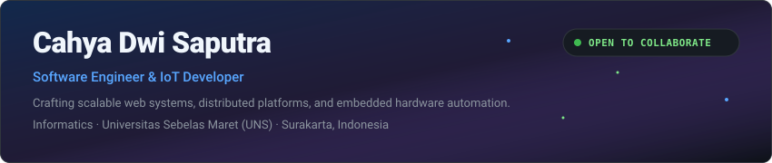

  

  

---

## Featured Projects

### [HPU Dashcam & Telemetry Monitoring System](https://github.com/CahyaDwiSaputra/Magang-HPU)
Enterprise vehicle monitoring and live video streaming dashboard built for PT HPU mining operations.
* **Dual-Channel Video Streaming:** Integrates with CMSV6 media gateways to stream front road view and cabin view with low latency.
* **Live GPS Tracking:** Displays real-time coordinates, hauling road stationing (STA), speed, and fuel levels on interactive map views.
* **Active Safety Synchronization:** Captures ADAS and DMS safety alerts, including harsh braking, sharp turns, collision alerts, and driver distraction warnings.
* **Stack:** `Laravel 13` `React 19 (Inertia.js)` `Tailwind CSS` `PostgreSQL` `CMSV6`

### [cuan.in: MSME Website Builder & Centralized Escrow](https://github.com/CahyaDwiSaputra/cuanin)
Multi-tenant e-commerce platform and centralized payment escrow gateway for Indonesian merchants.
* **Automated Escrow Vault:** Holds customer funds via Midtrans QRIS and automatically triggers disbursement payouts upon delivery verification.
* **Tenant Isolation:** Clean architectural separation between agency landing pages and isolated merchant storefronts on dedicated subdomains.
* **Stack:** `Node.js` `Express` `PostgreSQL` `Midtrans Snap` `Iris Payout API`

### [GrowMatic: Smart Farming & Microclimate Automation](https://github.com/CahyaDwiSaputra/GrowMatic)
IoT environmental monitoring and microclimate control system for oyster mushroom cultivation.
* **Microclimate Telemetry:** Monitors ambient temperature, air humidity, and substrate moisture levels in real time.
* **Automated Actuation:** Triggers misting pumps and ventilation fans dynamically based on sensor threshold rules.
* **Stack:** `ESP32` `Arduino Uno` `DHT11` `Soil Sensors` `JavaScript` `MySQL`

### [Hostuner: Cloud Webhosting Platform](https://github.com/CahyaDwiSaputra/hostuner-webhosting)
Storefront and management portal for webhosting, domain registrations, and cloud VPS instances.
* **WHMCS Integration:** Connects directly with WHMCS billing APIs for domain availability lookups, automated package provisioning, and invoice lifecycle management.
* **Stack:** `Vite` `React` `Node.js Express` `PostgreSQL` `WHMCS API`

### [Embedded Systems & Sensor Lab](https://github.com/CahyaDwiSaputra/arduino-iot-collection)
Curated collection of firmware implementations across ESP32 and Arduino Uno microcontrollers.
* **Implementations:** ESP32 RFID MFRC522 smart doorlock with SG90 servo actuation, wireless environmental station streaming to Blynk IoT Cloud, and ultrasonic proximity radar with 16x2 I2C LCD readouts.
* **Stack:** `C++` `ESP32` `Arduino Uno` `SPI` `I2C` `Blynk IoT`

---

## Technical Toolkit

### Languages

### Frameworks & Libraries

### Databases & Infrastructure

### IoT & Embedded Hardware

---

## Codebase Language Distribution

  

---

## Education

* **Universitas Sebelas Maret (UNS)**, Surakarta  
  Diploma in Informatics / Computer Science

---

## Contact

* Email: cahyadwisaputra@student.uns.ac.id
* GitHub: [github.com/CahyaDwiSaputra](https://github.com/CahyaDwiSaputra)
* Location: Surakarta, Indonesia
